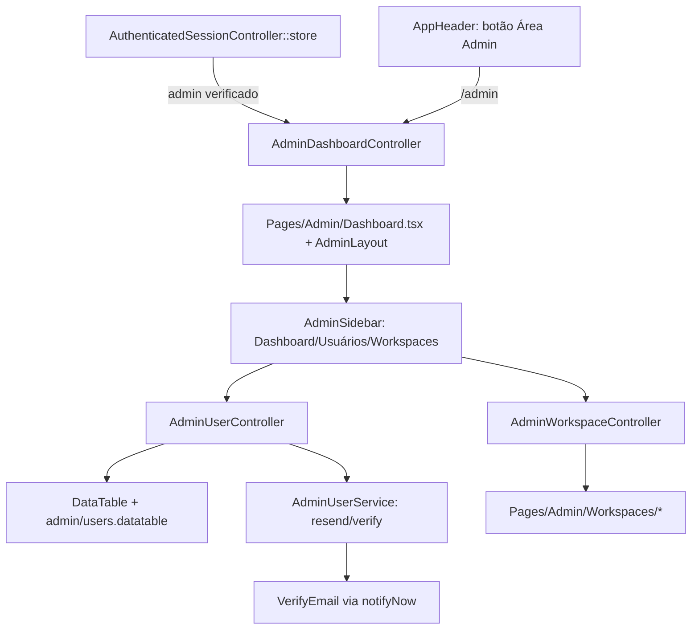

# Admin Backoffice — Design

**Spec:** `.specs/features/admin-backoffice/spec.md`
**Status:** Draft

---

## Architecture Overview

O backoffice é uma área **global** (sem escopo de workspace), paralela ao app existente. Backend: um grupo de rotas `admin.*` com `['auth', 'verified', 'ensure.admin']`, **fora** do grupo `ensure.has.workspace`. Frontend: `AdminLayout` próprio, páginas em `Pages/Admin/`, dados via ApiResources, listagem de usuários reutilizando a stack `DataTable` (JSON/axios + `DatatableService`).



Dois fluxos de requisição coexistem, como no resto do app:

- **Inertia** (GET views): controller → Resource collection → página React via props.
- **JSON/axios** (listagem de usuários): `GET admin/users.datatable` → `DatatableService::paginate()` → JSON `{data, meta}` consumido pelo hook `useDataTable`.

---

## Code Reuse Analysis

### Existing Components to Leverage

| Component | Location | How to Use |
|-----------|----------|------------|
| Atributo `#[Fillable]` Eloquent | `app/Models/User.php` (pattern) | `type` **não** entra no `#[Fillable]` — não-mass-assignável por construção |
| Pattern de enum com `label()` pt-BR | `app/Enums/WorkspaceRole.php` | Copiar estrutura para `App\Enums\UserType` |
| Redirect pós-login | `app/Http/Controllers/Auth/AuthenticatedSessionController::store()` | Inserir branch admin após o check `hasVerifiedEmail()` |
| Alias de middleware | `bootstrap/app.php` (`->withMiddleware(alias: ...)`) | Adicionar `'ensure.admin' => EnsureUserIsAdmin::class` |
| Padrão `ensure.has.workspace` | `app/Http/Middleware/EnsureHasWorkspace.php` | Referência de estilo para `EnsureUserIsAdmin` |
| `HandleInertiaRequests` shared data | `app/Http/Middleware/HandleInertiaRequests.php` | Adicionar `type` ao array `auth.user` |
| Consumo de flash + sonner | `resources/js/Layouts/AuthenticatedLayout.tsx` | Extrair para hook `useFlashToasts` e reutilizar em `AdminLayout` |
| `Toast::success()/error()` | `app/Support/Toast.php` | Flash de sucesso nas ações de suporte |
| `DatatableService` + `DatatableConfig` + `Filter` | `app/Services/Datatable/*` | Endpoint `admin/users.datatable` (search name/email + filtro verificação + sort) |
| `DataTable<T>` + `useDataTable` + tipos | `resources/js/Components/DataTable/*`, `resources/js/hooks/use-data-table.ts`, `resources/js/types/datatable.ts` | Listagem de usuários com `cell` customizadas (badge, dropdown de ações) |
| Padrão de refresh pós-mutação | `Pages/Transactions/Index.tsx` (`reloadTrigger`) | Recarregar tabela após reenviar/verificar manualmente |
| `UserResource` | `app/Http/Resources/UserResource.php` | Reaproveitado dentro de `AdminUserResource`/`MemberResource` (nested) |
| `MemberResource` (`{user, role, joined_at}`) | `app/Http/Resources/MemberResource.php` | Widget "Usuários do Workspace" (members + roles) |
| `WorkspaceResource` (com `role` via pivot) | `app/Http/Resources/WorkspaceResource.php` | Widget "Workspaces do Usuário" (roles no pivot) |
| Padrão de smoke test | `tests/Feature/Transactions/TransactionSmokeTest.php` | Um por rota GET do admin |
| Comando Cypress `assertToast` | `cypress/support/commands.js` | Toasts das ações admin (via `dispatchToast` CustomEvent) |
| Comandos Cypress com CSRF | `cypress/support/commands.js` (`seedNotifications` etc.) | Mesma mecânica para `POST /testing/create-admin` |
| `throttle:6,1` | rota `verification.send` em `routes/web.php` | Mesmo throttle no reenvio admin (Q7 confirmado) |

### Integration Points

| System | Integration Method |
|--------|--------------------|
| `users` migration | Nova migration adiciona coluna `type` (string, default `customer`); backfill implícito pelo default |
| `workspace_user` pivot | `User::workspaces()` (`withPivot('role')`) e `Workspace::members()` alimentam os widgets cruzados — sem novo model de pivot |
| Autenticação | `auth`, `verified` (Q2: mantido) + novo alias `ensure.admin` |
| Sessão de estado de tabela | **Não** usada para tabelas admin (v1): sem `PersistsTableState`, evita mexer no `DatatableStateController::ENTITY_MAP` (workspace-scoped). Estado de filtro vive só na sessão de navegação atual |
| Mail | `$user->notifyNow(new VerifyEmail)` — envio forçadamente síncrono, independente de `QUEUE_CONNECTION` |
| testing.* | Novo bloco não-produção **fora** do prefixo `w/{workspace}`: `POST /testing/create-admin` |

---

## Components

### Backend

#### `App\Enums\UserType`

- **Purpose:** Distinguir `admin` de `customer` (string-backed, `label()` pt-BR).
- **Location:** `app/Enums/UserType.php`
- **Interface:** `cases: Admin = 'admin', Customer = 'customer'`; `label(): string` → `'Administrador'` / `'Cliente'`.
- **Reuses:** Estrutura de `WorkspaceRole`.

#### Migration `add_type_to_users_table`

- **Purpose:** Coluna `type` string default `'customer'`, posicionada após `avatar`.
- **Location:** `database/migrations/2026_XX_XX_XXXXXX_add_type_to_users_table.php`
- **Notas:** `->after('avatar')`; **sem** backfill explícito (default cobre usuários existentes); sem índice (tabela pequena, filtro admin é por `email_verified_at`/name/email).

#### `App\Http\Middleware\EnsureUserIsAdmin`

- **Purpose:** Bloquear não-admins em todo `/admin/*` com 403.
- **Location:** `app/Http/Middleware/EnsureUserIsAdmin.php`; alias `ensure.admin` em `bootstrap/app.php`.
- **Interface:** `handle(Request, Closure)` → `if ($request->user()->type !== UserType::Admin) abort(403)`.
- **Notas:** Verifica **apenas** `type` (spec ADMB-02 AC5). Casar com `UserType::Admin` (enum), não string solta.

#### `App\Http\Controllers\Admin\AdminDashboardController`

- **Purpose:** GET `/admin` — shell Inertia do Dashboard.
- **Location:** `app/Http/Controllers/Admin/AdminDashboardController.php`
- **Interface:** `index(Request): InertiaResponse` → prop `activeUsers: int` (contagem de `email_verified_at !== null`).
- **Reuses:** Padrão de controllers Inertia existentes.

#### `App\Http\Controllers\Admin\AdminUserController`

- **Purpose:** Listagem, detalhe e ações de suporte sobre usuários.
- **Location:** `app/Http/Controllers/Admin/AdminUserController.php`
- **Interfaces:**
  - `index(Request): InertiaResponse` — shell da página (nenhum dado de linha; DataTable busca lazy).
  - `datatable(Request): JsonResponse` — `User::query()->withCount('workspaces')` + `DatatableService::paginate()`; config: `searchable(['name', 'email'])`, `Filter::select('email_verified_at', closure not-null vs null)`, `sortable(['name', 'email', 'created_at'])`, `defaultSort('created_at', 'desc')`, resource `AdminUserResource`.
  - `show(User $user): InertiaResponse` — `new AdminUserResource($user)` + `workspaces` via `$user->workspaces()->withPivot('role')->get()` (WorkspaceResource::collection, `role` já incluído via `whenPivotLoaded`).
  - `resendVerification(User $user): RedirectResponse` — `AdminUserService::resendVerification($user)` + `Toast::success('E-mail de verificação reenviado.')` + `back()`; service lança `ValidationException` (422) se já verificado.
  - `verify(User $user): RedirectResponse` — `AdminUserService::manuallyVerify($user)` + `Toast::success('Usuário marcado como verificado.')` + `back()`.
- **Dependencies:** `DatatableService`, `AdminUserService`.
- **Reuses:** `DatatableService`, `Toast`, pattern `back()` com flash.

#### `App\Services\Admin\AdminUserService`

- **Purpose:** Lógica de negócio das ações de suporte (D-16: fora do controller).
- **Location:** `app/Services/Admin/AdminUserService.php`
- **Interfaces:**
  - `activeUsersCount(): int` — `User::whereNotNull('email_verified_at')->count()`.
  - `resendVerification(User $user): void` — **guard**: se `email_verified_at !== null` → `ValidationException::withMessages(['user' => 'Usuário já verificado.'])`; senão `$user->notifyNow(new VerifyEmail)` (síncrono garantido).
  - `manuallyVerify(User $user): void` — mesmo guard; senão `$user->forceFill(['email_verified_at' => now()])->save()`.
- **Reuses:** Nada especial; `notifyNow` força sync sem depender de queue config.

#### `App\Http\Controllers\Admin\AdminWorkspaceController`

- **Purpose:** Listagem e detalhe (metadata-only) de workspaces.
- **Location:** `app/Http/Controllers/Admin/AdminWorkspaceController.php`
- **Interfaces:**
  - `index(): InertiaResponse` — `Workspace::query()->withCount('members')->orderBy('created_at', 'desc')->get()` → `AdminWorkspaceResource::collection` (v1: sem paginação — escopo operacional pequeno; página renderiza lista simples com botão Visualizar).
  - `show(Workspace $workspace): InertiaResponse` — prop `workspace` (AdminWorkspaceResource) + `members` via `$workspace->members()->withPivot('role', 'created_at')->get()` (MemberResource::collection). **Nenhuma** relação financeira é carregada (sem accounts/transactions/etc.).
- **Reuses:** `MemberResource`.

#### Resources

- **`AdminUserResource`** (`app/Http/Resources/AdminUserResource.php`): `uuid, name, email, type (string), email_verified_at (ISO|null), created_at, workspaces_count (whenCounted('workspaces'))`. Para o detalhe: quando usado com model não-counted, `workspaces_count` fica ausente (ok — detalhe usa widget separado).
- **`AdminWorkspaceResource`** (`app/Http/Resources/AdminWorkspaceResource.php`): `uuid, name, created_at, members_count (whenCounted('members'))`.

#### Rota de teste não-produção `testing.create-admin`

- **Purpose:** Semear + logar admin para Cypress (admins não surgem via UI por design).
- **Location:** bloco `if (! app()->environment('production'))` no nível raiz de `routes/web.php` (FORA do prefixo `w/{workspace}` — o backoffice é workspace-independent).
- **Interface:** `POST /testing/create-admin` — body `{email, name, password}`; `firstOrCreate` no User, `forceFill(['type' => admin, 'email_verified_at' => now()])->save()`, `Auth::login($user)`; 200. Nome: `testing.create-admin`.

#### Rotas

```php
Route::middleware(['auth', 'verified', 'ensure.admin'])->prefix('admin')->name('admin.')->group(function () {
    Route::get('/', [AdminDashboardController::class, 'index'])->name('dashboard');

    Route::get('users', [AdminUserController::class, 'index'])->name('users.index');
    Route::get('users.datatable', [AdminUserController::class, 'datatable'])->name('users.datatable'); // antes de users/{user}
    Route::get('users/{user}', [AdminUserController::class, 'show'])->name('users.show');
    Route::post('users/{user}/resend-verification', [AdminUserController::class, 'resendVerification'])
        ->name('users.resend-verification')->middleware('throttle:6,1');
    Route::post('users/{user}/verify', [AdminUserController::class, 'verify'])->name('users.verify');

    Route::get('workspaces', [AdminWorkspaceController::class, 'index'])->name('workspaces.index');
    Route::get('workspaces/{workspace}', [AdminWorkspaceController::class, 'show'])->name('workspaces.show');
});
```

Binding por UUID gratuito: `User`/`Workspace` já têm `getRouteKeyName() = 'uuid'`.

### Frontend

#### `Layouts/AdminLayout.tsx`

- **Purpose:** Layout dedicado do backoffice (header + sidebar + Toaster + flash).
- **Location:** `resources/js/Layouts/AdminLayout.tsx`
- **Interfaces:** props `{ children }`; usa `usePage()` p/ highlight de item ativo via `url`.
- **Conteúdo:** header "Fin · Backoffice Admin", sidebar com 3 itens (`data-testid="admin-sidebar-dashboard|users|workspaces"`), botão "Voltar para o App" → `route('workspace.select')`, `<Toaster position="top-right" closeButton />`, hook `useFlashToasts`.
- **Não usa:** `useWorkspace()` (lança sem workspace), workspace switcher.
- **Reuses:** hook `useFlashToasts` (extraído), primitivas shadcn.

#### `hooks/use-flash-toasts.ts` (extração)

- **Purpose:** Centralizar consumo `flash.success/error` → sonner + `dispatchToast` + limpeza em `router.on('before')`.
- **Location:** `resources/js/hooks/use-flash-toasts.ts`
- **Interface:** `useFlashToasts(): void`.
- **Notas:** Lógica movida **verbatim** de `AuthenticatedLayout.tsx` (inclui `consumedFlashRef` e `window.__toastBuffer` via `dispatchToast` — Cypress depende disso). `AuthenticatedLayout` passa a consumir o hook (regressão coberta pela suíte Cypress existente).

#### `Components/DropdownButton.tsx`

- **Purpose:** Botão-gatilho que abre `DropdownMenu` com itens de ação (spec ADMB-06).
- **Location:** `resources/js/Components/DropdownButton.tsx`
- **Interfaces:** `DropdownButtonProps { label?: string; icon?: LucideIcon; variant?: ButtonVariant; items: DropdownItem[] }`; `DropdownItem { label: string; onSelect: () => void; destructive?: boolean; disabled?: boolean }`.
- **Reuses:** shadcn `DropdownMenu` + `Button` (nenhum arquivo em `Components/ui/` é editado).

#### `Pages/Admin/Dashboard.tsx`

- **Purpose:** Home do backoffice com widget "Total de Usuários Ativos".
- **Location:** `resources/js/Pages/Admin/Dashboard.tsx`
- **Props:** `{ activeUsers: number }` (typed, do controller — ADMB-05 AC3).
- **Reuses:** `AdminLayout`, shadcn `Card`.

#### `Pages/Admin/Users/Index.tsx`

- **Purpose:** DataTable de usuários com busca, filtro de verificação e ações condicionais.
- **Location:** `resources/js/Pages/Admin/Users/Index.tsx`
- **Wiring (espelha `Transactions/Index.tsx`):** `<DataTable endpoint={route('admin.users.datatable')} columns={...} emptyState={...} />`; `reloadTrigger` para refresh pós-ação.
- **Colunas:** Nome, E-mail, Status Verificado (Badge "Verificado"/"Pendente" via `cell`), Workspaces (count), Data de Cadastro, Ações.
- **Ações (`cell` da coluna Ações):** sempre `Visualizar` (link para `admin.users.show`); se `email_verified_at === null` renderiza também `DropdownButton` com "Reenviar e-mail de confirmação" e "Marcar como verificado manualmente" (POST via `useForm({})` + `onSuccess: bumpReload`); usuários verificados **nunca** renderizam o dropdown (decisão Q5).
- **Filtro de verificação:** `DataTableFilter {type: 'select', options: [{label: 'Todos'|...}]}` mapeado para o filtro server-side `email_verified_at`.

#### `Pages/Admin/Users/Show.tsx`

- **Purpose:** Detalhe do usuário + widget "Workspaces do Usuário".
- **Location:** `resources/js/Pages/Admin/Users/Show.tsx`
- **Props:** `{ user: AdminUserDetail, workspaces: AdminWorkspaceRef[] }` (`AdminWorkspaceRef = {uuid, name, role}`).
- **Ações:** mesmas do listing quando `email_verified_at === null` (ocultas para verificados — Q5).

#### `Pages/Admin/Workspaces/Index.tsx` / `Show.tsx`

- **Purpose:** Listagem simples (Inertia, sem DataTable) e detalhe metadata-only + widget de membros.
- **Location:** `resources/js/Pages/Admin/Workspaces/`
- **Props Show:** `{ workspace: AdminWorkspaceDetail, members: AdminMember[] }` (`AdminMember = {user: {uuid, name, email}, role, joined_at}` — espelha `MemberResource`).

#### Modificações em código existente

| File | Change |
|------|--------|
| `app/Models/User.php` | Adicionar cast `'type' => UserType::class` (coluna **não** entra no `#[Fillable]`) |
| `app/Http/Controllers/Auth/AuthenticatedSessionController.php` | Em `store()`: após `hasVerifiedEmail()`, `if ($request->user()->type === UserType::Admin) return redirect()->route('admin.dashboard')` |
| `bootstrap/app.php` | Alias `ensure.admin` |
| `app/Http/Middleware/HandleInertiaRequests.php` | `auth.user` ganha `type: $user->type->value` (fallback `'customer'` para registros antigos sem migration rodada em teste) |
| `resources/js/Layouts/AuthenticatedLayout.tsx` | Flash/toast extraído para `useFlashToasts` (comportamento idêntico) |
| `resources/js/Components/AppHeader.tsx` | Botão "Área Admin" → `/admin`, renderizado **somente** se `auth.user?.type === 'admin'` |
| `routes/web.php` | Grupo `admin.*` + bloco `testing.create-admin` |
| `cypress/support/commands.js` | `cy.createAdminSession(email?)`: `cy.request('GET', '/login')` p/ CSRF (`meta[name=csrf-token]`) → `cy.request('POST', '/testing/create-admin', {email, name, password})` dentro de `cy.session` → `cy.visit('/admin')` |

#### Tipos TS

- **`resources/js/types/user.ts`** (ou inline em `types/index`): `UserType = 'admin' | 'customer'`; `SharedUser` ganha `type: UserType`.
- **`resources/js/types/admin.ts`**: `AdminUser`, `AdminWorkspace`, `AdminMember`, `AdminWorkspaceRef` conforme props acima.

---

## Data Models

### User (extensão)

```php
// migration: type: string, default 'customer', after 'avatar'
// cast: 'type' => UserType::class  (NOT in #[Fillable])
```

```typescript
type UserType = 'admin' | 'customer'
interface AdminUser {
  uuid: string; name: string; email: string; type: UserType
  email_verified_at: string | null; created_at: string
  workspaces_count?: number
}
```

### AdminWorkspace / AdminMember

```typescript
interface AdminWorkspace {
  uuid: string; name: string; created_at: string
  members_count?: number; role?: string  // role via pivot (widget do usuário)
}
interface AdminMember {
  user: { uuid: string; name: string; email: string }
  role: string          // 'admin' | 'editor' | 'viewer' (pivot)
  joined_at: string
}
```

**Relationships:** Nenhuma nova tabela/relação — tudo via `workspace_user` pivot existente (`withCount`, `withPivot('role')`).

---

## Error Handling Strategy

| Error Scenario | Handling | User Impact |
|----------------|----------|-------------|
| Customer acessa qualquer rota `/admin/*` | `EnsureUserIsAdmin` → `abort(403)` | Página 403 padrão do Laravel |
| Não autenticado em `/admin` | `auth` middleware | Redirect ao login (comportamento padrão) |
| Admin com e-mail não verificado em `/admin` | `verified` middleware | Tela de verificação (Q2) |
| Admin com zero workspaces | Grupo fora de `ensure.has.workspace` | 200 — backoffice funciona (spec ADMB-02 AC4) |
| Ação de suporte sobre usuário já verificado (defensiva) | Service lança `ValidationException` → 422 | UI nunca dispara (ações ocultas); guard é backstop (Q5) |
| Reenvio além do throttle | `throttle:6,1` → 429 | Sem toast especial; usuário aguarda (mesmo padrão do self-resend) |
| Busca por nomes com unicode/acentos | LIKE padrão do `DatatableService` (mesmo comportamento das tabelas existentes) | Sem quebra de paginação |

---

## Tech Decisions (non-obvious)

| Decision | Choice | Rationale |
|----------|--------|-----------|
| Reenvio síncrono | `$user->notifyNow(new VerifyEmail)` | `sendEmailVerificationNotification()` respeita `ShouldQueue`; `notifyNow` garante sync em qualquer `QUEUE_CONNECTION` (ADMB-08 AC1) |
| Toast flash compartilhado | Extrair `useFlashToasts` e usar nos dois layouts | Evita duplicar ~40 linhas de lógica de flash (incl. `consumedRef` + buffer do Cypress); regressão coberta por Cypress existente |
| Estado de tabela admin | **Sem** `PersistsTableState` (v1) | `DatatableStateController` é workspace-scoped (Gate + ENTITY_MAP); persistência de filtros admin não é requisito — evita tocar código do app |
| Guard 422 defensivo | `ValidationException::withMessages` no Service | UI não oferece as ações para verificados (Q5); o guard é backstop contra chamadas manuais |
| `users.datatable` antes de `users/{user}` | Ordem explícita de registro | Evita `{user}` capturar "users.datatable" (mesma precaução do grupo `w/{workspace}`) |
| Endpoint de teste fora do `w/{workspace}` | `POST /testing/create-admin` no nível raiz | Workspace-independent por natureza; mesmo guard não-produção do bloco existente |
| Botão "Voltar para o App" → `workspace.select` | Rota fora de `ensure.has.workspace` | Funciona para admin com zero workspaces (edge case da spec) |
| Widget do usuário usa `WorkspaceResource` | Pivot `role` já serializado via `whenPivotLoaded` | Zero código novo para "Papel/Role" no widget |
| Contagem de ativos no controller via Service | `AdminUserService::activeUsersCount()` | D-16 (lógica de negócio em Service), mesmo que trivial |

---

## Testing Strategy (resumo; detalhes na spec)

- **PHPUnit:** `tests/Feature/Admin/` — `UserTypeTest`, `AuthorizationTest`, `AuthRedirectTest`, `DashboardTest`, `UsersListingTest`, `UserActionsTest` (Mail::fake + notifyNow assert), `UserDetailTest`, `WorkspaceDetailTest` + 5 smoke tests (um por rota GET).
- **Cypress:** `cypress/e2e/admin/{backoffice,users,cross-navigation}.cy.ts` (spec naming existente usa `.cy.js` — seguir `.cy.ts`/`.cy.js` conforme pasta) com `cy.createAdminSession()`; smoke no topo de cada spec.
- **Gates:** `php artisan test`, `composer quality`, `npm run quality`, `npm run build`, Cypress verde.
